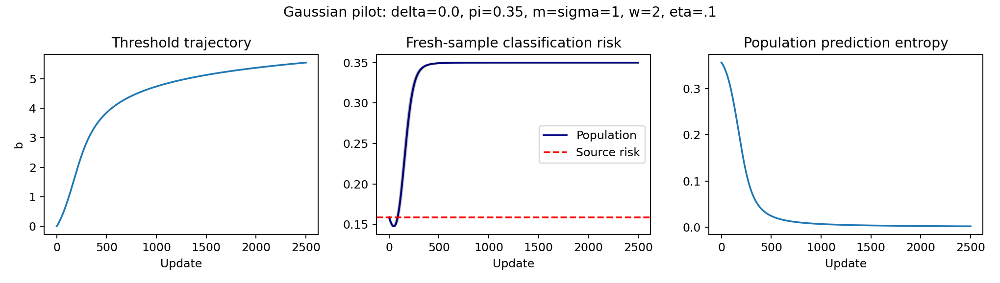

# 初步数值结果，2026-10-24

这是与原始 pilot 输出一起保留的历史实验分析，以下结论按当次运行范围解读。当前理论完成范围、采用证据与后续安排见根目录 [STATUS.md](../STATUS.md)；运行方式见 [README.md](README.md)。

实际运行，CPU，使用项目约定的 Python 环境（见根目录 AGENTS.md）。未跑 GPU 或图像数据。探索性扫描，不是预注册实验，也不用于宣称新颖性。

运行方式见 [理论复现实验 README](code/entropy/README.md)。

固定 m=σ=1，w=2，η=.1，共 2500 更新。δ∈{−.6,−.3,0,.3,.6,1}，π∈{.2,.35,.5,.65,.8}，共 30 格。160 点标准正态 Gauss–Hermite 求总体梯度，风险由 Gaussian CDF 精确计算。8 格满足风险最低值比初始低 .001 以上，且最终超过初始 .005；全部格保存在 `population_grid.csv`，不只保留成功结果。

为展示从成功格中选取最终风险与最低风险差最大的案例，δ=0、π=.35：

| 量 | 实测值 |
|---|---:|
| 初始风险 | .158655254 |
| 最低风险 | .147597606 |
| 最低风险步数 | 47 |
| 首次超过初始风险 + .005 | 94 |
| 第 2500 步风险 | .349999044 |
| 初始 / 最终总体熵 | .356316360 / .001850989 |

40 条独立路径、每步 fresh batch n=64、随机种子生成器初始值 20261024。最终风险 10/50/90 分位均约 .349999。40 条路径的终态一致不等于首次越界时间已有集中定理。当前展示 δ=0，因此后续须对 δ≠0 的区域证明和独立验证，不能据这张图声称混合偏移的一般相图已完成。

在选定案例 b∈[−4,4] 的 41 个点，160 / 256 点积分梯度最大差 3.04e−15；单点中心有限差分检查熵梯度，绝对差 1.92e−11。检查的是实现和求积一致性，非严格数值积分误差认证。

`pilot_summary.json` 为结构摘要，`pilot_paths.npz` 保存总体阈值、风险、熵和所有 SGD 路径；`pilot.py` 可重新生成结果。这里的阈值逃逸与风险回升只说明模型存在可研究现象，不代表所有混合物都会坍塌。高分离情形可能存在稳定低密度边界。
